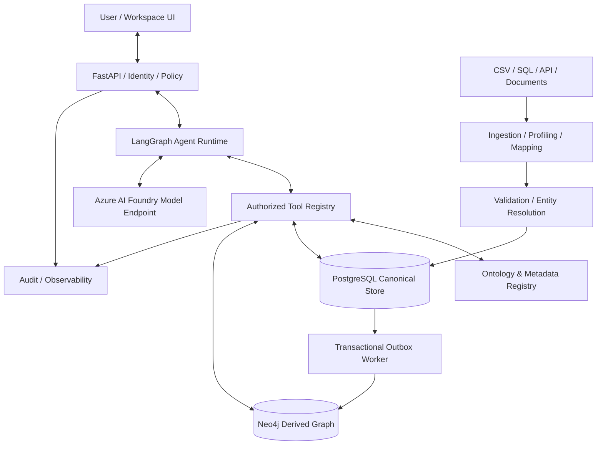
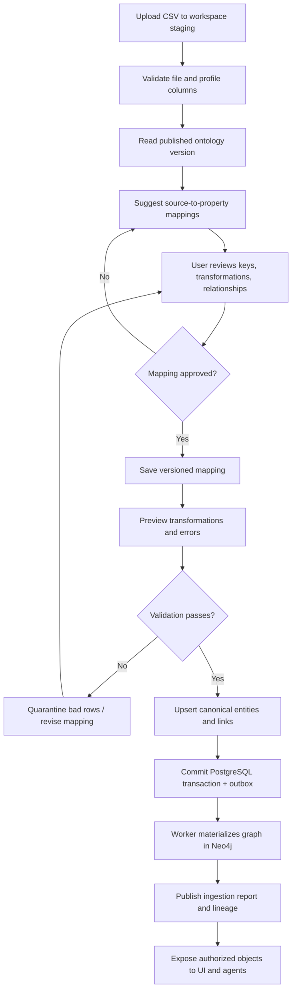
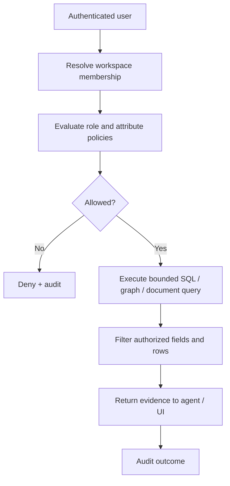
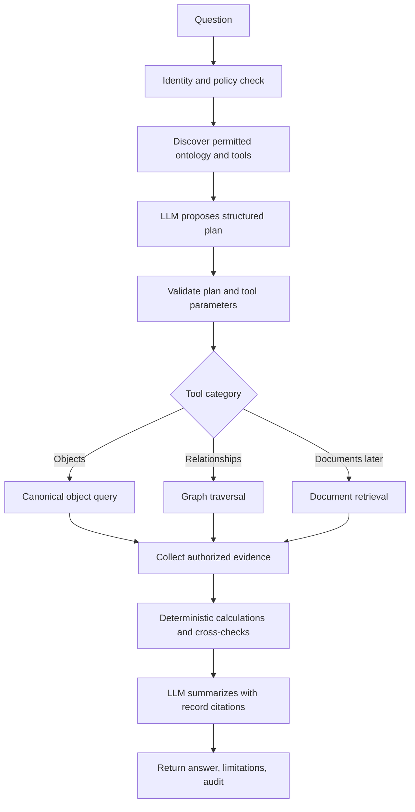
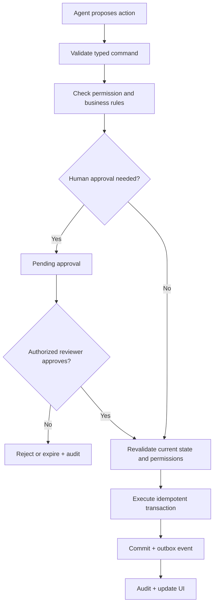

# PROJECT KRITA
## Internal Product, Solution Architecture & Website Engineering Blueprint

**Version:** 0.2 — Solution Architecture Edition  
**Date:** 14 October 2026  
**Classification:** Confidential — internal concept and engineering design  
**Status:** Proposed architecture; do not represent mockups or planned features as implemented.  
**Primary audience:** Website-building agent, product designer, senior engineer, future internal collaborators.

> **Product thesis:** From Data Chaos to Structural Intelligence. Krita transforms fragmented enterprise records into governed business objects, connected relationships, evidence-backed AI answers, and approved operational actions.

---

# 1. Purpose and scope

This is the source-of-truth specification for building **Krita's private internal product knowledge website** and describing the eventual **Krita enterprise intelligence application**. The first deliverable is a polished documentation/product-explainer website, **not** a claim that the backend exists. Use realistic but clearly labeled synthetic examples, interactive conceptual flows, architecture diagrams, and transparent implementation status.

**Deliverable A — Internal portal:** static website with product narrative, system diagrams, detailed technical flows, conceptual UI previews, security and deployment guidance, roadmap, and searchable engineering docs.

**Deliverable B — Product platform (later):** actual multi-workspace ingestion, ontology, graph, AI, and operational action services.

**Non-goals for portal V0.1:** production patient data, real banking integrations, live clinical decision support, unsupervised write operations, production-grade multi-tenancy, model training, or claiming parity with Palantir.

# 2. Brand, meaning, and positioning

**Krita (कृत)** is inspired by Sanskrit notions of something accomplished, completed, or well-formed, and by **Krita Yuga**, associated with an ideal age of truth, balance, and order. The product promise is to create structural clarity from complex enterprise data. The short name is intended to feel contemporary and accessible to Canadian and US buyers.

**Brand line:** From Data Chaos to Structural Intelligence.  
**Alternative supporting line:** One intelligence core. Multiple industries. Unified understanding.

**Product family:**

| Product | Responsibility | Stage |
|---|---|---|
| **Krita Core** | Domain-independent ingestion, ontology, graph, intelligence, permissions, and actions | Architecture/design |
| **Krita Pulse** | Healthcare ontologies, patient/encounter/provider/facility examples, clinical-operations intelligence | First synthetic demonstration |
| **Krita Ledger** | Banking accounts, customers, transactions, risk, and compliance investigation | Planned second-domain validation |

**Positioning:** Krita is not merely a chatbot, BI dashboard, graph database, or ETL utility. It connects these capabilities through a governed business ontology. This project is inspired by publicly observable enterprise intelligence patterns; it is not a reverse-engineered copy of proprietary Palantir code.

# 3. Problems and value proposition

Enterprises maintain data across SQL, CSV, APIs, documents, departmental tools, and legacy systems. Identifiers differ; permissions vary; documents lack structured relationships; analysis is manual and hard to audit. Krita proposes a reusable layer to normalize sources, establish canonical objects, trace lineage, traverse connections, answer questions with evidence, and perform only authorized actions.

**Before:** siloed records, inconsistent IDs, manual joins, document searches, opaque analysis, scattered permissions.  
**After (target):** typed business objects, connected relationships, reusable query tools, evidence-backed responses, centralized policy enforcement, explicit approval workflows.

**Audience for website:** technical collaborators, internal reviewers, architects, prospective authorized partners. Show both executive explanations and expandable developer detail.

# 4. Product principles and architecture decisions

1. **Domain independence:** healthcare, banking, insurance, finance use the same core; domain packages provide ontology definitions, mappings, tools, and screens.
2. **Ontology-first:** business meaning is explicit and versioned, not inferred anew by an LLM for every question.
3. **PostgreSQL is authoritative:** object records, relationship definitions, schema metadata, lineage, approvals, and outbox events are canonical; Neo4j is a derived relationship index.
4. **Model replaceability:** Azure AI Foundry is the initial hosted LLM inference provider; an adapter can later use Ollama or llama.cpp.
5. **Agent-as-planner, application-as-authority:** the LLM selects approved tools; trusted code checks policies, executes queries, and commits actions.
6. **Security before retrieval:** workspace, object, document, and property-level controls are applied before evidence reaches the model.
7. **Human approval for consequential writes:** propose → authorize → approve → revalidate → execute → audit.
8. **Evidence and provenance:** answers reference authorized object IDs, source files, and lineage.
9. **Synthetic-first:** no real healthcare or banking data in prototype or website.
10. **Status honesty:** distinguish Concept, Planned, In progress, Implemented, and Verified throughout the site.

# 5. System context and logical layers



**Eight logical layers:** (1) source connectivity; (2) data processing; (3) storage/indexing; (4) ontology/metadata; (5) operational actions; (6) AI intelligence; (7) API/identity; (8) experience. These are responsibilities, not necessarily separately deployed microservices.

**Recommended MVP stack:** Astro + MDX + Tailwind + Mermaid for private portal; React/TypeScript for future product UI; Python 3.12+, FastAPI, Pydantic, SQLAlchemy/Alembic, Polars; PostgreSQL; Neo4j Community (trusted gateway only); LangGraph; Azure AI Foundry inference; Docker Compose; pytest and Playwright; OpenTelemetry. Add Qdrant only when document search is in scope.

# 6. Krita Pulse first demonstration — synthetic healthcare CSV

**Workspace:** My Enterprise Workspace  
**Illustrative workspace ID:** `ws_healthcare_001` (display/demo ID, not a production UUID)  
**Domain:** healthcare  
**Source:** CSV  
**Model:** Azure AI Foundry, inference only  
**Data:** entirely synthetic

## 6.1 Sample CSV

```csv
patient_no,visit_id,visit_date,doctor_id,facility_id,diagnosis_code
P001,V100,2026-01-10,D01,F01,DX001
P002,V101,2026-01-11,D02,F01,DX002
P001,V102,2026-02-04,D02,F02,DX001
```

This file alone provides IDs, not complete provider, facility, or diagnosis records. The pipeline must not fabricate their attributes. References remain unresolved until relevant source records exist, or are represented as explicitly approved reference-only placeholders.

## 6.2 Ontology entities

| Entity | Canonical key | Example properties | Relationships |
|---|---|---|---|
| Patient | patient_id | patient_id, region | HAS_ENCOUNTER → Encounter |
| Encounter | encounter_id | encounter_date, status, provider_id | ATTENDED_BY → Provider; AT_FACILITY → Facility; HAS_DIAGNOSIS → Diagnosis |
| Provider | provider_id | provider_id, specialty | ATTENDED_BY inverse |
| Facility | facility_id | facility_id, facility_type | AT_FACILITY inverse |
| Diagnosis | diagnosis_code | code, description | HAS_DIAGNOSIS inverse |

## 6.3 CSV-to-ontology mappings

| Source column | Target | Transform | Validation |
|---|---|---|---|
| patient_no | Patient.patient_id | trim/string | required, nonempty |
| visit_id | Encounter.encounter_id | trim/string | required, unique per workspace/entity/source identity |
| visit_date | Encounter.encounter_date | ISO date parse | valid date |
| doctor_id | Encounter.provider_id | trim/string | optional unresolved reference |
| facility_id | Encounter.facility_id | trim/string | optional unresolved reference |
| diagnosis_code | Encounter.diagnosis_code | trim/string | optional unresolved reference |

## 6.4 Mapping flow



**Expected from the three sample rows:** 2 unique Patients, 3 Encounters, 3 HAS_ENCOUNTER links. Provider references D01 and D02 are **two distinct unresolved provider identifiers**, not two failed rows; facilities and diagnosis codes also require resolution. Counts must be labeled illustrative, not actual system metrics.

## 6.5 Ingestion invariants

- Source key identity is scoped to workspace and entity type; no cross-workspace merging.
- Re-importing identical rows is idempotent; changed rows follow an explicit update/version policy.
- A row cannot create an unapproved entity type or relationship type.
- Date parsing, null handling, required fields, and uniqueness are deterministic.
- Failed rows are quarantined with reasons; never silently discarded.
- PostgreSQL commits canonical objects, links, lineage, and outbox atomically.
- Neo4j sync is asynchronous, retryable, idempotent, and reports lag/failure.
- The ingestion job stores mapping version, ontology version, file fingerprint, actor, timestamps, and row counts.

# 7. Dynamic ontology registry

An ontology is a versioned business schema defining **entity types, properties, primary keys, relationship types, cardinality, allowed actions, and security classifications**. The engine reads these definitions; it must not require changing core Python classes for each new domain.

```yaml
ontology:
  domain: healthcare
  version: 1
entities:
  Patient:
    key: patient_id
    properties:
      patient_id: {type: string, required: true, classification: restricted}
      region: {type: string, classification: internal}
  Encounter:
    key: encounter_id
    properties:
      encounter_id: {type: string, required: true}
      encounter_date: {type: date}
      provider_id: {type: string}
relationships:
  HAS_ENCOUNTER:
    source: Patient
    target: Encounter
    cardinality: one_to_many
actions:
  flag_encounter_for_review:
    target: Encounter
    permission: encounter.review
    approval_required: true
```

**Registry lifecycle:** Draft → schema validation → review → immutable published version → migration plan → activation → tool discovery. Breaking changes require explicit migrations and rollback strategy.

**Core metadata tables:** `workspaces`, `workspace_members`, `ontology_versions`, `entity_types`, `relationship_types`, `entity_records`, `entity_links`, `data_sources`, `schema_mappings`, `ingestion_jobs`, `tool_definitions`, `approval_requests`, `outbox_events`, `audit_events`.

**Example canonical object storage:** composite `(workspace_id, record_id)` primary key; `(workspace_id, entity_type_id, external_key)` unique constraint; `properties JSONB`; `ontology_version`; lineage and timestamps. Add database foreign keys, indexes, row-level security, and immutable history as migrations.

# 8. Workspace isolation, security and privacy

- Authenticate users; derive workspace context from verified membership, never LLM arguments.
- Enforce PostgreSQL Row-Level Security and application authorization with tests for bypass paths.
- Restrict Neo4j to a trusted query service using parameterized, workspace-scoped traversals. Neo4j Community workspace predicates alone are not equivalent to strong tenant isolation.
- Partition uploaded files, jobs, audit events, and indexes by workspace.
- Apply record/property-level policies before returning data to an agent or model.
- Require explicit approval for consequential writes, with post-approval revalidation.
- Audit actor, workspace, tool, object IDs, decision, outcome, and time; minimize retention of sensitive content.
- Use TLS, encryption at rest, secrets management, retention rules, monitoring, backups, and incident procedures for eventual production.
- Use **synthetic healthcare records** for demo. Real patient data may invoke PHIPA and other obligations; perform privacy/security/legal review and confirm cloud processing configuration first.



# 9. AI intelligence and extensible tools

**Model choice:** Azure AI Foundry hosted inference first; no need to train a new LLM or run local models. Implement a provider abstraction to support local models later. Only send minimum authorized evidence to the model.

**Agent approach:** one LangGraph workflow with schema discovery and typed tools; introduce multiple specialized agents only when demonstrated complexity warrants it.

**Universal tools:** `list_entity_types`, `get_entity_schema`, `query_entities`, `get_entity`, `traverse_relationships`, `get_source_lineage`, and later `search_documents`. Domain tools include `get_patient_encounters` (Pulse) and `analyze_account_transactions` (Ledger).

**Tool contract fields:** stable name/version, description, input/output JSON schemas, required permission, allowed entity types, bounded query limits, timeout, audit policy, and deterministic handler. Reject arbitrary SQL/Cypher generated by the model.



**Example question:** “Show all encounters for patient P001, involved providers, and repeat visits within 30 days.” The application performs deterministic date arithmetic; the model summarizes returned evidence, references encounter IDs, and must not invent clinical conclusions.

# 10. Controlled operational actions



Do not allow LLM output to directly modify data. Actions are explicit commands with permission, approval, concurrency, and audit semantics.

# 11. Private website information architecture

The **first website is a product knowledge portal**, not the operational application. Pages should use a consistent shell with sidebar/top navigation, breadcrumbs, page title, status label, reading time, table of contents, and related-page links.

| Route | Purpose | Required content |
|---|---|---|
| `/` | Hero and overview | Mission, problem/solution, product family, core visual |
| `/vision` | Brand and strategy | Sanskrit meaning, Krita Yuga inspiration, market positioning |
| `/architecture` | System design | Layer diagram, service boundaries, data/control flows |
| `/data-lifecycle` | Ingestion walkthrough | CSV upload → profile → map → validate → commit → graph |
| `/ontology` | Ontology engine | Entities, properties, links, versioning, examples |
| `/intelligence` | AI agents | LangGraph, model gateway, tool calls, evidence and actions |
| `/security` | Governance | Isolation, policies, privacy, audit, human approval |
| `/products/pulse` | Healthcare example | Synthetic CSV, mapping table, encounter graph, investigation |
| `/products/ledger` | Banking example | Synthetic account/transaction ontology; clearly planned |
| `/product-preview` | UI concepts | Workspace, Mapping Studio, Graph Explorer, Chat, Approvals |
| `/developers` | Engineering | Stack, APIs, repository, local setup, ADRs |
| `/roadmap` | Delivery plan | Planned/In progress/Implemented/Verified with evidence |

**Navigation:** Overview, Platform, Data Flow, Ontology, AI Intelligence, Products, Security, Developer Docs, Roadmap. Include prominent **Internal / Confidential** classification and a legend explaining feature statuses.

# 12. Website visual design specification

**Visual language:** premium technical B2B; dark navy/near-black backgrounds, restrained electric-blue accents, generous spacing, clear type hierarchy, accessible contrast, subtle linework and node/edge motifs. Avoid neon overload, misleading metrics, fake testimonials, invented client logos, or unearned “production ready” badges.

**Suggested tokens:** background `#0B1220`, surface `#101E32`, border `#28415F`, accent `#85B9FF`, primary text `#F7FAFF`, secondary text `#B3C1D4`. Verify WCAG contrast.

**Interactive components:** clickable architecture layers revealing responsibilities; step-by-step CSV mapping simulator; domain switcher showing Pulse vs Ledger; graph visualization with synthetic objects; accordion for engineering detail; implementation-status filters. Static diagrams must remain comprehensible without animation.

**Conceptual product UI screens:** Workspace Dashboard, Data Mapping Studio, Ontology Registry, Graph Explorer, AI Investigation Workspace, Approval Center, Ingestion Job Monitor, Audit Trail. Label all mock data and screenshots **Concept** until backed by real functionality.

**Hero copy:**

> KRITA — Bring structure to complexity. Connect fragmented data. Build a living ontology. Discover relationships. Turn intelligence into governed action.

**Homepage sections:** hero → before/after problem → Krita Core architecture → three-step workflow → product modules → Pulse interactive demonstration → governance → roadmap → internal documentation links.

# 13. Website agent implementation instructions

**Preferred stack:** Astro, MDX, Tailwind CSS, Mermaid; use small React islands only where interaction materially improves understanding. Build responsive desktop/mobile layouts and accessible keyboard navigation.

**Agent tasks:**

1. Scaffold `docs-site/` with Astro, TypeScript, Tailwind, content collections, navigation, and design tokens.
2. Convert this blueprint into modular page content, preserving status labels and confidentiality notices.
3. Build Mermaid diagrams for system, ingestion, ontology lifecycle, agent query, security, and approval flows.
4. Build an interactive **synthetic CSV mapping preview**: columns on left, ontology targets on right, editable choices, mapping JSON export; clearly mark no live backend.
5. Build a healthcare graph explorer using hardcoded synthetic objects P001/P002, V100/V101/V102; explain unresolved provider references.
6. Build a domain toggle for Pulse and Ledger; demonstrate how only ontology/mapping config changes.
7. Add architecture-decision pages and a roadmap with evidence-based status badges.
8. Run formatting, type checks, accessibility checks, link checks, and production build; fix errors.
9. Add a README covering installation, local run, build, content authoring, deployment security, and known limitations.
10. Do not add external analytics, third-party trackers, public deployment, or real integrations without approval.

**Website acceptance tests:** all routes work; no placeholder broken links; no confidential content fetched from public URLs; all diagrams render; mapping preview responds to input; domain switcher works; mobile layout usable; no claims of implemented backend; build succeeds; README enables a fresh clone to run locally.

# 14. Future application API design

| Method | Endpoint | Responsibility |
|---|---|---|
| POST | `/api/v1/workspaces` | Create workspace |
| GET | `/api/v1/workspaces/{id}` | Workspace metadata |
| POST | `/api/v1/ontology/entities` | Register entity type |
| POST | `/api/v1/ontology/relationships` | Register link type |
| POST | `/api/v1/ontology/publish` | Publish schema version |
| POST | `/api/v1/ingestion/csv/profile` | Profile CSV |
| POST | `/api/v1/ingestion/mappings` | Save approved mapping |
| POST | `/api/v1/ingestion/jobs` | Start ingestion |
| GET | `/api/v1/ingestion/jobs/{id}` | Status and errors |
| GET | `/api/v1/entities` | Authorized entity query |
| GET | `/api/v1/graph/neighbors` | Authorized traversal |
| GET | `/api/v1/tools` | Discover permitted tools |
| POST | `/api/v1/agents/query` | Evidence-backed agent query |

All endpoints need authenticated context, input validation, request limits, authorization, audit, and predictable error contracts before real deployment.

# 15. Repository layout and development environments

```text
project-krita/
├── docs-site/                 # First deliverable: internal product portal
│   ├── src/pages/
│   ├── src/components/
│   ├── src/content/
│   └── public/
├── platform/                  # Future functional Krita Core
│   ├── apps/api/
│   ├── apps/web/
│   ├── apps/worker/
│   ├── packages/ontology/
│   ├── packages/ingestion/
│   ├── packages/tools/
│   ├── packages/security/
│   └── domains/healthcare/
├── examples/synthetic-data/
├── infrastructure/
├── architecture/decisions/
├── tests/
├── .github/workflows/
└── README.md
```

**Local:** MacBook, Astro dev server, optional Docker for later platform services. **Model:** Azure AI Foundry only when live agent integration is added. **Version control:** private GitHub repository. **Important:** a private GitHub repository does not by itself make a deployed website private. For now prefer local access or authenticated hosting; avoid assuming GitHub Pages is private.

# 16. Phased roadmap and release gates

| Phase | Deliverable | Release gate |
|---|---|---|
| 1 | Private product knowledge portal | Navigable pages, accurate diagrams, concept labels, passing build |
| 2 | Krita Core foundation | Workspace identity, PostgreSQL, registry APIs, tests |
| 3 | Data Mapping Studio backend | CSV profiling, approved mappings, validated idempotent imports |
| 4 | Relationship intelligence | Neo4j derived sync, graph query API, lineage |
| 5 | AI intelligence | Foundry adapter, LangGraph tools, grounded response evaluations |
| 6 | Krita Pulse demo | Synthetic patient/encounter end-to-end demonstration |
| 7 | Krita Ledger demo | Banking data added without core changes |
| 8 | Hardening | Approvals, stronger isolation, observability, threat modeling |

**Technical success criteria:** two domain ontologies with no core code change; repeat import without duplicate objects; cross-workspace denial tests; graph consistency after outbox processing; grounded answers with authorized source references; unapproved actions rejected; errors retry safely.

# 17. Risks, decisions, and open questions

**Risks:** false entity matches, inconsistent graph sync, accidental PHI exposure, model hallucinations, tenant leakage, unbounded agent queries, prompt injection via documents, costly hosted inference, scope creep, misleading demo claims, unauthenticated hosting.

**Mitigations:** synthetic-first, deterministic identity policies, mapping approval, source lineage, outbox retries, policy enforcement before retrieval, bounded tools, human review, budgets and tracing, verified status labels, authenticated website access.

**Open decisions for engineering:** identity provider for production; exact tenant isolation tier; entity-resolution policy; file retention; graph deployment choice; Foundry model/deployment region; observability backend; hosting provider; deployment access policy; real domain data governance. Do not invent decisions where none have been made.

# 18. Terminology and glossary

- **Workspace:** isolated organizational context with members, sources, ontologies, and permissions.
- **Ontology:** published definitions of business objects, properties, relationships, and actions.
- **Canonical object:** normalized business record with stable identity.
- **Entity resolution:** matching source records to canonical identities under explicit rules.
- **Mapping:** versioned transformation from source columns to ontology properties.
- **Lineage:** trace from an object or answer to original source and processing steps.
- **Outbox:** transactional event record consumed to update derived systems reliably.
- **Agent tool:** typed, authorized operation callable through orchestration.
- **Grounding:** tying an answer to verified, authorized evidence.
- **Human-in-the-loop:** authorized review before consequential operations.
- **Krita Core:** shared platform; **Pulse:** healthcare domain; **Ledger:** banking domain.

# 19. Immediate handoff to website-building agent

**Build now:** the internal portal, not a simulated full backend. Prioritize the overview, architecture, data lifecycle, ontology, Krita Pulse, intelligence, security, and roadmap. Build the mapping and graph demonstrations with synthetic in-browser data. Keep content in MDX so it can be maintained without changing React components. Add clear links between high-level explanations and detailed engineering flows.

**Completion checklist:**

- [ ] All routes in section 11 implemented and navigable.
- [ ] Branding and Krita Core / Pulse / Ledger distinction consistent.
- [ ] At least six rendered flow diagrams with explanatory captions.
- [ ] Mapping simulator works with synthetic healthcare CSV.
- [ ] Ontology graph shows P001/P002 and V100/V101/V102 correctly.
- [ ] Domain switcher demonstrates configuration-driven extensibility.
- [ ] Security and privacy limitations are prominent.
- [ ] No unverified performance statistics or production claims.
- [ ] Responsive, accessible, fast static site.
- [ ] README with setup/build and authenticated-hosting guidance.
- [ ] Private repository; no public deployment without explicit authorization.

---

**End of internal blueprint.** Treat this document as the initial product specification and revise it with dated architecture decisions and verified implementation evidence as Krita develops.

---


# 20. Solution architect diagram pack — implementation-grade

> **Status:** All diagrams in this section describe the **target architecture**, not a claim of implemented software. The rendered PNGs are in `krita_architecture_assets/`; their editable Graphviz DOT sources are supplied alongside them. The Word edition embeds all diagrams directly. The Markdown edition links to the image assets; distribute the Markdown and assets together (the ZIP includes both).

## 20.1 Architecture views and reading order

The diagrams use a consistent visual vocabulary: blue = core component; green = authoritative or successfully committed state; amber = external dependency or approval gate; red = denied/error path. Arrows indicate primary control/data dependencies, not a guarantee of synchronous calls. The system context diagram is the top-level view; ingestion, identity, AI, and approvals are separate flows.

### Diagram 01 — System context and trust boundaries


**Editable diagram source:** `krita_architecture_assets/01_system_context.dot`.

### Diagram 02 — Krita Core modular component architecture


**Editable diagram source:** `krita_architecture_assets/02_component_architecture.dot`.

### Diagram 03 — CSV onboarding, mapping and ingestion decision flow


**Editable diagram source:** `krita_architecture_assets/03_ingestion_mapping.dot`.

### Diagram 04 — One healthcare CSV row to canonical ontology objects


**Editable diagram source:** `krita_architecture_assets/04_mapping_transform.dot`.

### Diagram 05 — Ontology registry lifecycle and migration gates


**Editable diagram source:** `krita_architecture_assets/05_ontology_lifecycle.dot`.

### Diagram 06 — Governed agent question-answer execution


**Editable diagram source:** `krita_architecture_assets/06_agent_query.dot`.

### Diagram 07 — Workspace isolation and policy enforcement


**Editable diagram source:** `krita_architecture_assets/07_workspace_security.dot`.

### Diagram 08 — Sensitive operational action approval workflow


**Editable diagram source:** `krita_architecture_assets/08_action_approval.dot`.

### Diagram 09 — Internal documentation website information architecture


**Editable diagram source:** `krita_architecture_assets/09_portal_sitemap.dot`.

### Diagram 10 — Private portal and local engineering deployment topology


**Editable diagram source:** `krita_architecture_assets/10_deployment.dot`.

### Diagram 11 — Ingestion service sequence and transactional outbox


**Editable diagram source:** `krita_architecture_assets/11_sequence_ingestion.dot`.

### Diagram 12 — Proof of domain independence: same Krita Core


**Editable diagram source:** `krita_architecture_assets/12_domain_independence.dot`.

## 20.2 Data mapping design contract

**Actors:** Workspace Administrator (creates sources), Data Steward (approves mappings), Ingestion Worker (executes), Ontology Registry (validates target schema), Policy Engine (authorizes), Outbox Consumer (projects graph).

**Preconditions:** authenticated workspace membership; published ontology version; staged synthetic CSV; permitted upload size and content; source-system namespace and primary-key policy chosen.

**Inputs:** `workspace_id` from verified request context, `source_id`, `file_id`, `ontology_version`, `mapping_version`, CSV delimiter/encoding/header settings, row-level error policy, identity namespace.

**Outputs:** ingestion job report, accepted/rejected row counts, created/updated/unchanged objects, relationship counts, unresolved reference counts, lineage pointers, outbox projection state.

**Critical invariants:**

1. Workspace identity is never inferred from file contents or supplied by the LLM.
2. A mapping version is immutable once an ingestion job references it.
3. Object identity uses `(workspace, entity_type, source_namespace, normalized_business_key)` or a documented entity-resolution rule; the same business key across different source namespaces is not automatically the same person.
4. Every write is validated against the pinned ontology version.
5. Each committed object/link change and its outbox event are part of the same PostgreSQL transaction.
6. Replaying a job must not duplicate records or graph edges.
7. Unresolved provider/facility references are tracked explicitly, not hallucinated into complete entities.
8. Graph reads can be temporarily stale relative to PostgreSQL; UI should show projection lag when material.
9. Quarantined rows never silently become accepted records.
10. Sensitive fields are classified and redacted before any model-assisted mapping request.

### Mapping rule model

```yaml
mapping:
  id: hospital_visits_v1
  source_id: synthetic_hospital_visits
  ontology_version: 1
  status: approved
  encoding: utf-8
  entities:
    - type: Patient
      source_key: [patient_no]
      namespace: hospital_a
      fields:
        patient_id: {column: patient_no, transform: trim}
    - type: Encounter
      source_key: [visit_id]
      namespace: hospital_a
      fields:
        encounter_id: {column: visit_id, transform: trim}
        encounter_date: {column: visit_date, transform: iso_date}
  relationships:
    - type: HAS_ENCOUNTER
      from: {type: Patient, key_column: patient_no}
      to: {type: Encounter, key_column: visit_id}
  references:
    - target_type: Provider
      key_column: doctor_id
      on_missing: defer
  errors:
    on_invalid_row: quarantine
    max_error_rate: 0.05
```

### Worked three-row example

| patient_no | visit_id | visit_date | doctor_id |
|---|---|---|---|
| P001 | V100 | 2026-01-10 | D01 |
| P002 | V101 | 2026-01-11 | D02 |
| P001 | V102 | 2026-02-04 | D02 |

**Expected authoritative results:** 2 Patient objects; 3 Encounter objects; 3 `HAS_ENCOUNTER` links; 2 distinct unresolved Provider references (D01, D02) until the provider source is imported. Re-import unchanged CSV: 0 duplicate canonical objects. `Provider` relationships are not materialized until target identity resolution succeeds.

### Failure and recovery matrix

| Failure | Detection | Required behavior | Recovery |
|---|---|---|---|
| Unsupported CSV encoding | Staging/profile | Reject with actionable error | User selects supported encoding |
| Missing patient key | Row validation | Quarantine row; count in job | Fix source/mapping, rerun |
| Duplicate encounter key with conflicting values | Identity/upsert | Apply explicit conflict policy; never silent overwrite | Steward reviews conflict |
| Unknown ontology property | Mapping validation | Block approval | Select valid property or publish schema update |
| Missing Provider target | Reference resolver | Defer and count unresolved reference | Import provider source, reconcile |
| PostgreSQL transaction fails | Worker | Roll back entire transaction/batch | Idempotent retry |
| Neo4j unavailable | Outbox consumer | Retain committed event and retry | Resume projection; expose lag |
| Unauthorized workspace | API/policy | Deny before staging/query | Membership correction by admin |
| Model suggestion inaccurate | Human approval | Do not auto-apply | Steward edits mapping |

## 20.3 Storage and data ownership

**PostgreSQL (source of truth):** `workspaces`, `workspace_members`, `ontology_versions`, `entity_types`, `relationship_types`, `data_sources`, `schema_mappings`, `ingestion_jobs`, `entity_records`, `entity_links`, `source_lineage`, `outbox_events`, `tool_definitions`, `approval_requests`, `audit_events`.

**Neo4j (derived):** nodes keyed by immutable canonical object IDs plus workspace IDs, and edges keyed by canonical relationship IDs. Only trusted backend services may issue Cypher. Treat graph projection as eventually consistent; never use Neo4j as the authoritative store for approval or identity.

**File staging:** workspace-scoped storage with content hash, size, encoding, upload actor, and retention policy. Do not commit sensitive CSV files to Git.

**Azure AI Foundry:** model inference only in the first phase. Prompt context must be minimized, classified, and authorized. Real health information requires legal, privacy, residency, contractual, and security review before processing.

## 20.4 Workspace isolation threat model

| Threat | Attack path | Control | Verification |
|---|---|---|---|
| Cross-tenant SQL read | Forged workspace ID | Server-derived scope + PostgreSQL RLS | Negative integration test |
| Cross-tenant graph traversal | Arbitrary Cypher / missing predicate | No direct Cypher; parameterized graph gateway | Workspace-crossing traversal test |
| Prompt-injection tool misuse | Malicious CSV/document content | Tool allowlist, policy checks, untrusted content separation | Adversarial agent evaluation |
| Unauthorized action | Model calls write tool | RBAC/ABAC, approval, revalidation | Denied-action test |
| Sensitive prompt leakage | Raw PII sent to LLM | Field classification, redaction, context minimization | Prompt payload inspection |
| Replay/duplicate import | Worker retry | Idempotency keys + uniqueness constraints | Replay test |
| Untracked graph drift | Outbox worker crash | Durable events, retries, reconciliation | Fault-injection test |

## 20.5 Agent orchestration contract

**Read flow:** request → authentication → workspace policy → discover ontology → choose allowed tools → validate structured arguments → execute bounded deterministic queries → filter fields → assemble evidence → model synthesis → return record-level citations → audit.

**Write flow:** propose action → validate schema and permission → create approval request if required → reviewer decision → revalidate state/version → execute idempotent business command → transaction + audit + outbox. The model never directly issues unrestricted SQL or Cypher and never self-approves.

**Initial tools:** `list_entity_types`, `get_entity_schema`, `query_entities`, `get_entity`, `traverse_relationships`, `get_source_lineage`. Each tool declares Pydantic input/output schema, permission, workspace-scoped execution context, timeout, pagination/max results, audit policy, and error taxonomy.

## 20.6 Website implementation specification for the coding agent

**Target:** internal documentation and interactive conceptual demonstrator; not a functional patient-data system.

**Framework:** Astro + MDX + Tailwind CSS; React islands for interactive mapping explorer; Mermaid or rendered diagram assets for flows. Do not require a running backend for the documentation portal.

**Page map and required modules:**

| Route | Required content | Interaction |
|---|---|---|
| `/` | Hero, thesis, Krita family, architecture summary, status | Product navigation |
| `/architecture` | System context, components, deployment, data ownership | Zoomable diagrams |
| `/data-lifecycle` | CSV pipeline, error paths, outbox, lineage | Step-through flow |
| `/mapping-studio` | Source preview, mapping rule editor, validation report | Synthetic-only mapping simulator |
| `/ontology` | Registry, versions, object/relationship definitions | Switch healthcare/banking examples |
| `/agents` | LangGraph flow, tool gateway, evidence, approvals | Expand tool-call trace |
| `/security` | Workspace isolation, threat model, governance | Policy decision examples |
| `/pulse` | Healthcare walkthrough, sample CSV, encounter graph | Patient P001 example |
| `/ledger` | Banking ontology and domain independence | Account/transaction example |
| `/developer` | APIs, repo layout, contracts, testing | Copy code snippets |
| `/roadmap` | Phases, acceptance criteria, current status | Filter by status |

**Design:** professional dark navy background, blue accent, accessible typography, desktop/mobile navigation, persistent status tags (Concept / Planned / Implemented / Verified), syntax-highlighted code, captions for every diagram, searchable docs, no fabricated product metrics or customers.

**Security for hosting:** private GitHub repository alone does not make the deployed site private. Use authenticated hosting or local-only access; no public deployment without explicit authorization. Keep `.env`, secrets, tokens, and real datasets out of repository. CI should run formatting, link checks, TypeScript checks, build, and Playwright smoke tests.

**Agent deliverables:** full source code, working `npm install && npm run dev`, production static build, responsive pages, integrated diagrams, synthetic mapping simulator, README, `.env.example` only if needed, accessibility checks, and test evidence. The site must never label a simulated data import as a real successful ingestion.

## 20.7 Acceptance criteria and phased release gates

| Gate | Definition of done |
|---|---|
| Documentation site | All routes render; diagrams readable; no broken image links; private-access guidance present |
| Mapping simulation | 3 synthetic CSV rows map to 2 Patients, 3 Encounters, 3 links, 2 deferred provider refs |
| Core ontology | Can publish healthcare and banking schema versions using same registry |
| Ingestion | Stable keys, row quarantine, lineage, idempotent replay, durable outbox |
| Graph | No cross-workspace traversal; projection catches up after simulated outage |
| Agent | Only allowed tools execute; answers cite authorized records; denied calls audited |
| Actions | Sensitive writes require approval; retries do not duplicate effects |
| Domain independence | Banking domain onboarded without edits to universal Krita Core business logic |

## 20.8 Implementation order and decisions to record

1. Private documentation portal and diagram pack.
2. FastAPI + PostgreSQL migrations + workspace membership + RLS tests.
3. Dynamic ontology registry and version lifecycle.
4. CSV staging, profiler, mapping editor, dry-run, validation and canonical upsert.
5. Durable outbox and Neo4j projection with reconciliation.
6. Read-only universal tool registry and LangGraph integration.
7. Krita Pulse synthetic end-to-end evaluation.
8. Krita Ledger second-domain independence test.
9. Action approval workflow and operational hardening.

**Architecture decision records (ADRs) to create:** authoritative PostgreSQL vs graph; ontology version semantics; entity identity and resolution; row quarantine thresholds; graph consistency guarantees; model gateway and residency; workspace isolation tier; document/vector search deferral; private portal hosting; tool execution and approval policy.

---

**Confidentiality:** Internal design. All patient, account, and transaction examples are synthetic. This blueprint describes proposed capabilities; it is not evidence of deployed functionality or proprietary Palantir implementation details.
